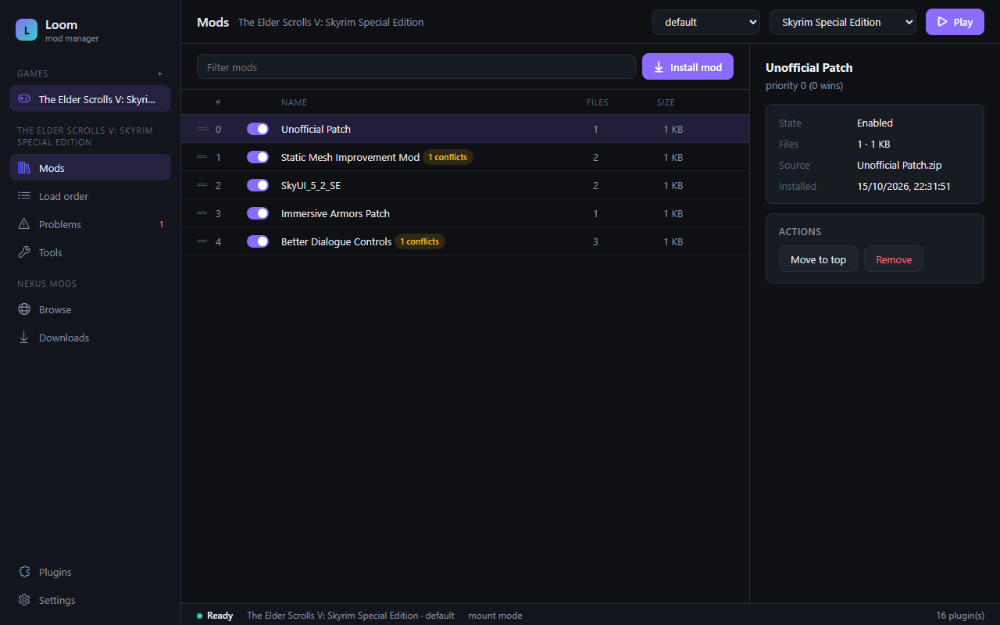
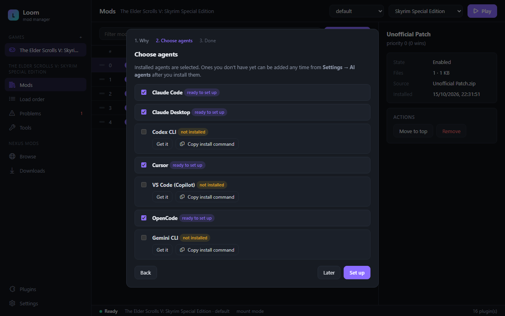

# Loom

**A mod manager that never touches your game folder.**

Loom projects your mods into the game through a virtual file system
([openvfs](https://github.com/enrell/openvfs)): the game sees every enabled mod,
in your priority order, while its real folder stays byte-for-byte the way the
store installed it. Writes the game makes land in a per-profile *overwrite*
folder. Uninstall Loom and nothing is left behind.



- **Every game is a plugin.** The core knows no game. Support comes from small,
  declarative `loom-plugin.toml` files installed Go-style from their repository
  (`github.com/owner/repo/dir@v1.2.0`). Plugins can't contain code, so installing
  one can never run anything. Drop a plugin and its game goes away without
  touching anything else.
- **A marketplace made of links.** [`marketplace/`](marketplace) lists reviewed
  plugins, each pinned to a content hash. Anyone can add a plugin by pull
  request; automated checks and a review agent assess it.
- **Built for agents.** Everything you can do in the app, an AI agent can do through
  the CLI (`--json`) or the MCP server (`loom mcp`). `loom doctor` reports every
  problem with a code and the exact command that fixes it.
- **Tools inside the view.** Translators (SSE Auto Translator, xTranslator), xEdit,
  BodySlide, Nemesis… run against the modded game without deploying anything, and
  their output becomes a regular, toggleable *Generated* mod.
- **Nexus Mods built in.** Browse Nexus inside the app; *Mod Manager Download*
  links go straight to Loom, which downloads and installs them.

## Supported games

Official plugins (in [`plugins/`](plugins)): Skyrim Special Edition / Anniversary
Edition, Skyrim, Fallout 4, Fallout: New Vegas, Fallout 3, Oblivion, Starfield,
Cyberpunk 2077, The Witcher 3, Stardew Valley, Mount & Blade II: Bannerlord,
Valheim, RimWorld, Kingdom Come: Deliverance, Darkest Dungeon, Hogwarts Legacy.
Adding one is a TOML file — see [docs/PLUGINS.md](docs/PLUGINS.md).

## Status

MVP. Windows only for now (openvfs's mount and hook backends are Windows).
Games run through a WinFsp mount (install [WinFsp](https://winfsp.dev):
`winget install WinFsp.WinFsp`) or, without it, through openvfs's per-process
hook.

## Using it

The desktop app (`apps/desktop`) covers everything below with a UI. The CLI:

```
loom market install skyrimse            # add game support (hash-verified)
loom game add skyrimse                  # finds the game (Steam, GOG, registry)
loom mod install skyrimse SkyUI.7z      # archives are laid out automatically
loom order sort skyrimse                # masters first, every plugin after its masters
loom doctor skyrimse                    # problems + the command that fixes each
loom launch skyrimse --exe skse         # play, with mods, game folder untouched
loom tool run skyrimse sse-at           # a tool in the virtual view → "Generated - …" mod
loom nxm "nxm://skyrimspecialedition/mods/12604/files/…"   # Nexus download + install
```

Add `--json` to any command for machine-readable output.

### Agents (MCP + skill)

On first launch the desktop app offers a wizard that connects the AI coding
agents you have — Claude Code, Claude Desktop, Codex CLI, Cursor, VS Code
(Copilot), OpenCode, Gemini CLI — to Loom: it registers Loom's MCP server in each
one's config (merging, with a one-time backup) and installs the Loom skill in
agents that read [Agent Skills](https://agentskills.io). Agents you install later
are added from **Settings → AI agents**. From the command line:

```
loom agents list                # installed agents and whether Loom is set up
loom agents setup --all         # or: loom agents setup claude-code codex
loom agents remove cursor
loom agents skill <dir>         # write the skill folder, e.g. to upload elsewhere
```

Any other MCP client can run `loom mcp` (or `loom-desktop.exe mcp`) on stdio.
The agent gets typed tools (`loom_mods`, `loom_load_order_sort`, `loom_doctor`,
`loom_market_install`, `loom_tool_run`, …) and fixes setups by running
`loom_doctor`, applying fixes, and checking again.



## Building

Loom builds against a sibling checkout of openvfs:

```
git clone https://github.com/enrell/openvfs
git clone https://github.com/enrell/loom
cd loom
cargo test --workspace                  # core, CLI, MCP (+ an end-to-end test)
cd apps/desktop && npm ci && npx tauri build
```

### Installing from source

The install scripts build this checkout (cloning openvfs next to it if needed)
and install Loom for your user, with no admin or root needed:

```
.\scripts\install.ps1              # Windows: %LOCALAPPDATA%\Programs\Loom, PATH, Start menu, Apps & features
scripts/install.sh                 # Linux: ~/.local/bin + app launcher entry and icons
```

Run the script again with `-Update` / `--update` to pull loom and openvfs and
rebuild only if something changed. Updating works while Loom is open: the new
binaries take effect the next time it starts. `-Nxm` / `--nxm` makes Loom the
handler for Nexus "Mod Manager Download" links, and uninstalling gives those
links back to the previous handler. `-CliOnly` / `--cli-only` skips the desktop
app, and `-Uninstall` / `--uninstall` removes everything except your mod
library. On Linux the desktop app needs WebKitGTK
([Tauri prerequisites](https://v2.tauri.app/start/prerequisites/#linux)), and
launching games is still Windows-only.

Headless UI work: `npm run build:mock` serves the UI with recorded data, and
`python scripts/ui-shots.py` screenshots every screen with headless Edge.

## Layout

```
crates/loom-plugin   plugin format + validation
crates/loom-core     the engine (games, mods, profiles, load order, doctor, launch, plugins, marketplace, Nexus)
crates/loom-cli      the `loom` command (+ `loom mcp`)
crates/loom-mcp      MCP server
apps/desktop         Tauri 2 desktop app
plugins/             official game plugins
marketplace/         the plugin index, contribution guide and review checklist
docs/                architecture, plugin authoring
prototypes/          the Electron / Tauri / egui comparison behind the UI choice
```

See [docs/ARCHITECTURE.md](docs/ARCHITECTURE.md) for the design and
[CONTRIBUTING.md](CONTRIBUTING.md) to help.

## License

MIT
