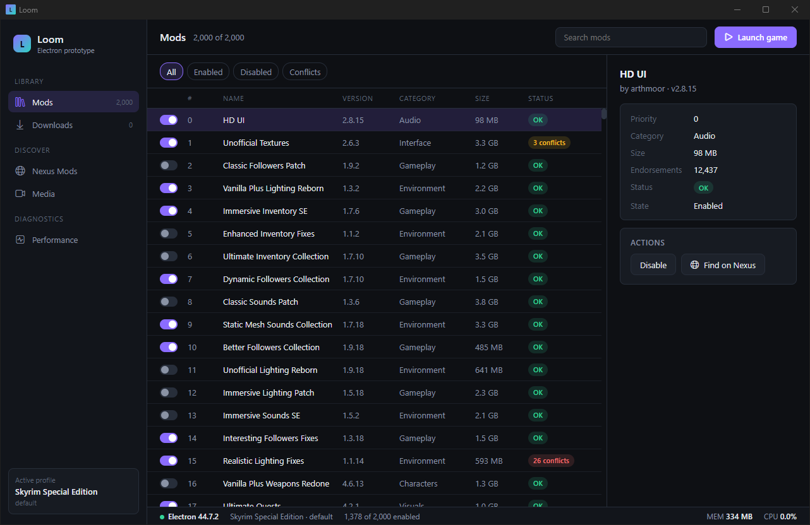
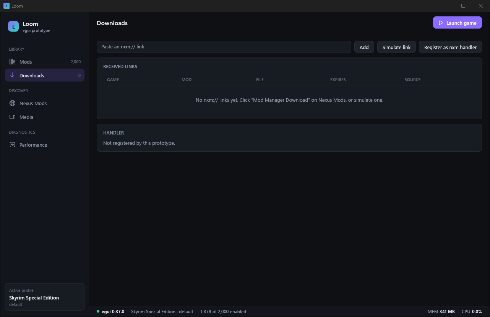
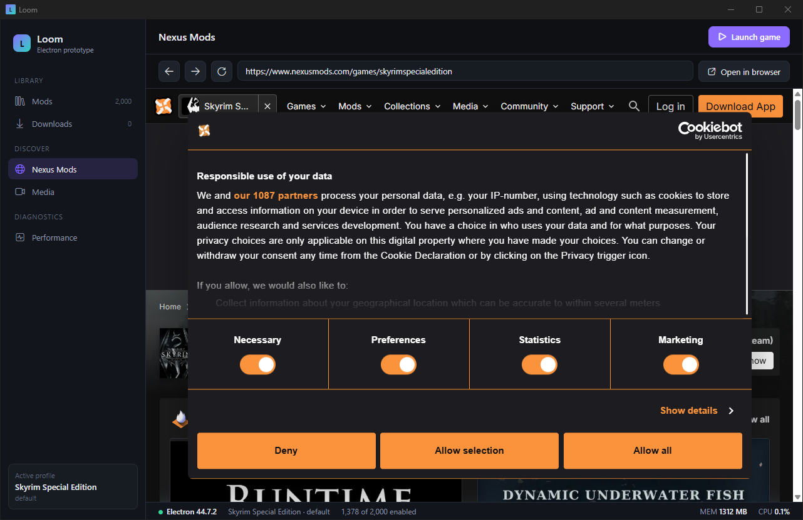
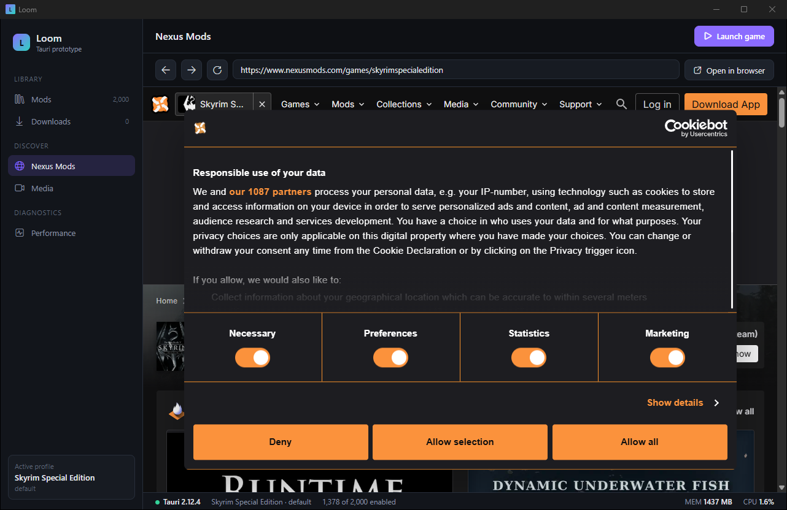
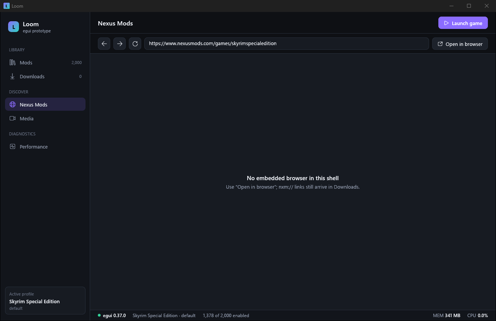
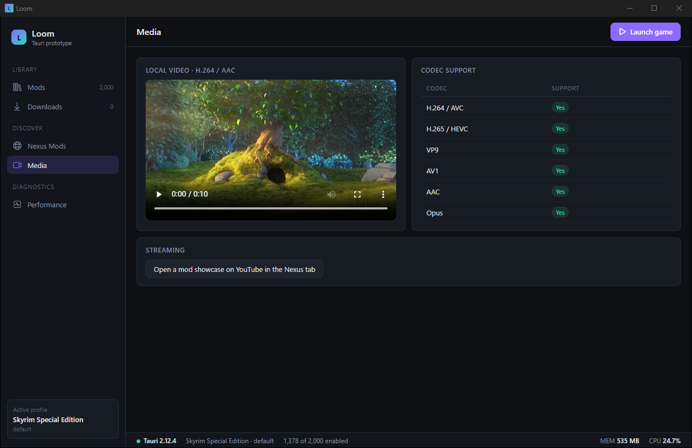
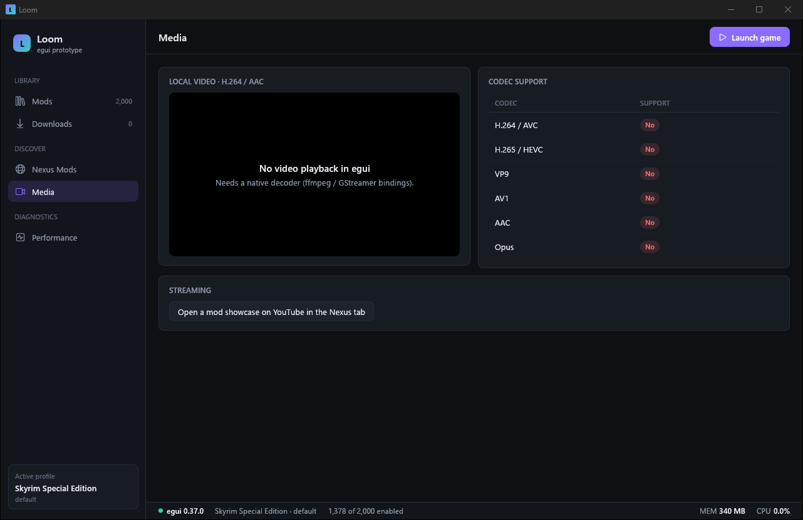
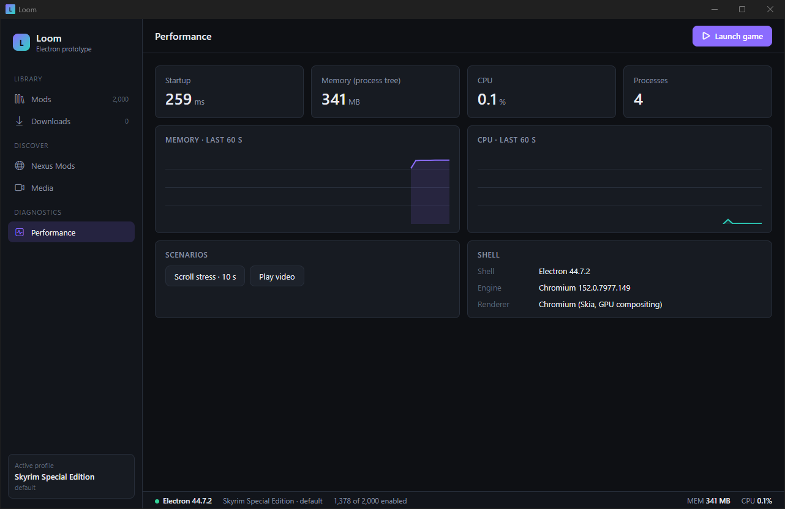
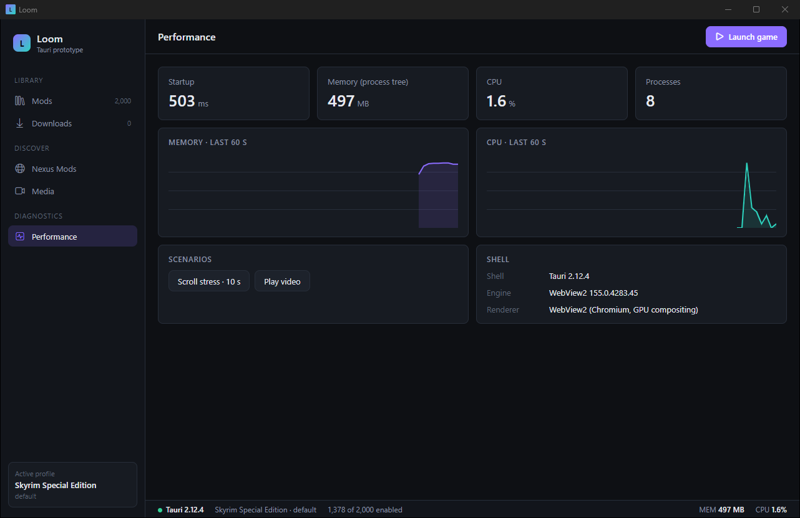
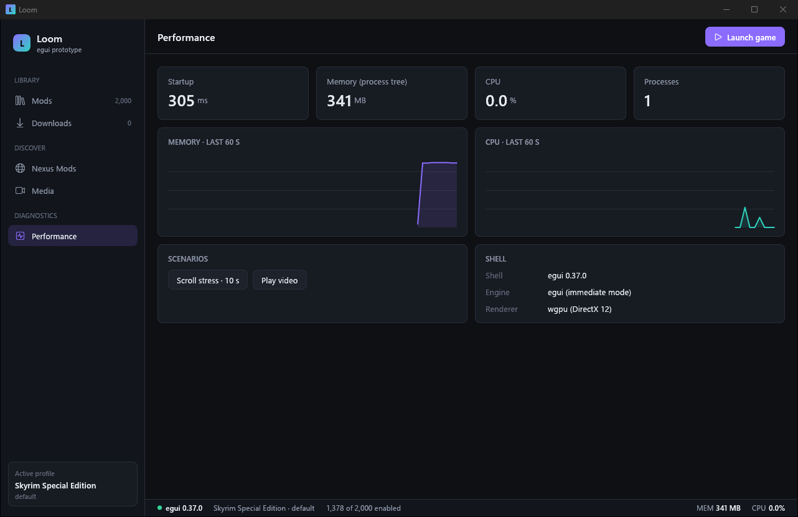

# Loom UI shells — Electron vs Tauri vs egui

**Outcome: Tauri 2 on a Rust core — see [DECISION.md](DECISION.md).**

Three prototypes of the same Loom screen (mod list with 2,000 mods, downloads/nxm, embedded
Nexus Mods browser, media, live performance). Electron and Tauri run the very same
`ui/` (HTML/CSS/JS); egui redraws it natively from the same design tokens and data
generator. `egui (glow)` is the same egui app with the OpenGL renderer instead of wgpu.

Measured 2026-10-16 00:16 on 12th Gen Intel(R) Core(TM) i7-12700H, 20 logical CPUs,
40 GB RAM, Windows-11-10.0.26300-SP0. Rust builds without sccache, `rust-lld` linker.
Every number covers the whole process tree (Windows Job Object): rustc/cargo/node during
builds; renderer, GPU and WebView2 helper processes at runtime.

Conditions: the test windows ran on the laptop's built-in screen (1920×1200, 100 %, Intel Iris Xe)
while the main screen was in use, so CPU numbers carry some background noise. egui uses the
low-power (integrated) GPU, like Chromium/WebView2 do by default.

## Screenshots

| Electron | Tauri | egui |
|---|---|---|
|  |  |  |
|  |  |  |
|  |  |  |
|  |  |  |
|  |  |  |

## Features

| | Electron | Tauri | egui |
|---|---|---|---|
| Same UI code | `ui/` as is | `ui/` as is | redrawn in Rust (same tokens, data, layout) |
| Embedded browser | ✅ own Chromium (`WebContentsView`) | ✅ WebView2 child webview (`unstable` feature) | ❌ none — opens the system browser |
| Nexus Mods + login page + Cloudflare check | ✅ | ✅ | — |
| `nxm://` from Windows (second instance) | ✅ single-instance lock | ✅ single-instance plugin | ✅ (hand-rolled local socket) |
| `nxm://` clicked inside the embedded browser | ✅ caught before Windows | ✅ caught before Windows | — |
| Local H.264/AAC video | ✅ | ✅ | ❌ needs ffmpeg/GStreamer bindings |
| Calling openvfs (Rust) | via a native addon (napi-rs) or a helper process | direct, same process | direct, same process |
| Linux | same Chromium everywhere | WebKitGTK (different engine, weaker video/codecs) | same code |

Login itself (Nexus account, Google SSO) was not exercised: it needs real credentials.

## Build

### Clean release build

| | Electron | Tauri | egui (wgpu) | egui (glow) |
|---|---:|---:|---:|---:|
| Wall time | **6.2 s** | 2 min 7 s | 1 min 44 s | 1 min 14 s |
| CPU time (all processes) | **3.8 s** | 13 min 51 s | 17 min 28 s | 11 min 48 s |
| Peak memory (job commit) | **887 MB** | 4,191 MB | 4,283 MB | 3,146 MB |
| Peak working set (sampled) | **913 MB** | 3,547 MB | 3,659 MB | 2,480 MB |

### Incremental release build (one source file touched)

| | Electron | Tauri | egui (wgpu) | egui (glow) |
|---|---:|---:|---:|---:|
| Wall time | 6.6 s | 28.9 s | 3.8 s | **2.6 s** |
| CPU time (all processes) | **4.0 s** | 2 min 45 s | 9.4 s | 7.7 s |
| Peak memory (job commit) | 886 MB | 1,690 MB | 810 MB | **618 MB** |
| Peak working set (sampled) | 913 MB | 1,372 MB | 329 MB | **292 MB** |

### Clean debug build

| | Electron | Tauri | egui (wgpu) | egui (glow) |
|---|---:|---:|---:|---:|
| Wall time | — | 1 min 30 s | 1 min 13 s | **1 min 0 s** |
| CPU time (all processes) | — | 6 min 17 s | 6 min 19 s | **4 min 21 s** |
| Peak memory (job commit) | — | 4,036 MB | 4,960 MB | **3,929 MB** |
| Peak working set (sampled) | — | 3,238 MB | 3,640 MB | **2,751 MB** |

### Incremental debug build (the dev loop)

| | Electron | Tauri | egui (wgpu) | egui (glow) |
|---|---:|---:|---:|---:|
| Wall time | — | 6.8 s | 4.2 s | **3.4 s** |
| CPU time (all processes) | — | 15.7 s | 7.5 s | **4.7 s** |
| Peak memory (job commit) | — | 1,449 MB | 1,577 MB | **1,094 MB** |
| Peak working set (sampled) | — | **1,034 MB** | 1,757 MB | 1,055 MB |

Electron has no compile step: its "build" is copying the UI and packaging (asar + runtime).

### Artifact

| | Electron | Tauri | egui (wgpu) | egui (glow) |
|---|---:|---:|---:|---:|
| Size on disk | 368 MB | 10 MB | 14 MB | **7.7 MB** |

Tauri also needs the WebView2 runtime (preinstalled on Windows 10/11, ~shared with Edge).

## Runtime

### Startup (launch → first frame painted)

| | Electron | Tauri | egui (wgpu) | egui (glow) |
|---|---:|---:|---:|---:|
| Median | 269 ms | 514 ms | 300 ms | **129 ms** |
| Best | 261 ms | 503 ms | 289 ms | **128 ms** |

### Idle on the mod list (20 s)

| | Electron | Tauri | egui (wgpu) | egui (glow) |
|---|---:|---:|---:|---:|
| CPU (% of one core) | **0.8 %** | 0.9 % | 0.9 % | 0.9 % |
| Private memory | 171 MB | 238 MB | 290 MB | **54 MB** |
| Working set | 337 MB | 489 MB | 342 MB | **103 MB** |
| Processes | 4 | 8 | **1** | **1** |

### Scrolling the 2,000-mod list continuously (15 s)

| | Electron | Tauri | egui (wgpu) | egui (glow) |
|---|---:|---:|---:|---:|
| CPU (% of one core) | 33.3 % | 30.7 % | **10.1 %** | 15.5 % |
| Private memory | 249 MB | 320 MB | 288 MB | **56 MB** |
| Working set | 432 MB | 589 MB | 341 MB | **105 MB** |
| Processes | 4 | 8 | **1** | **1** |

### Playing the local video (15 s)

| | Electron | Tauri | egui (wgpu) | egui (glow) |
|---|---:|---:|---:|---:|
| CPU (% of one core) | 9.5 % | **8.0 %** | — | — |
| Private memory | 309 MB | **285 MB** | — | — |
| Working set | **481 MB** | 533 MB | — | — |
| Processes | **4** | 8 | — | — |

### Nexus Mods page open in the embedded browser (15 s, after 15 s to load)

| | Electron | Tauri | egui (wgpu) | egui (glow) |
|---|---:|---:|---:|---:|
| CPU (% of one core) | **1.5 %** | 2.8 % | — | — |
| Private memory | **909 MB** | 943 MB | — | — |
| Working set | 1,613 MB | **1,410 MB** | — | — |
| Processes | **11** | 15 | — | — |

CPU is the job's total CPU time over the window divided by wall time (100 % = one full
core). Working set double-counts pages shared between processes; private memory does not.

## How to reproduce

```
python bench/run_all.py      # builds, runtime, screenshots, nxm tests, this report
```
